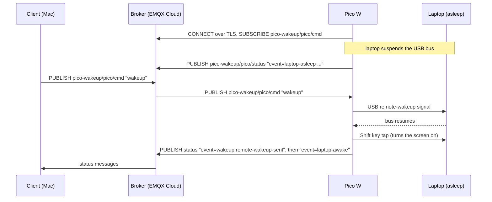
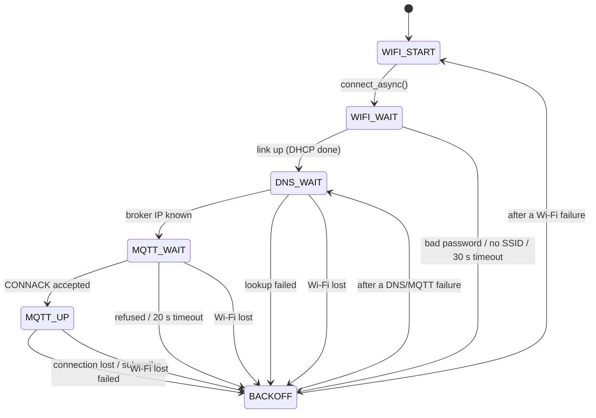

# How it works

A walk through the design and the firmware, written for learning. Back to the
[README](../README.md).

- [The big picture](#the-big-picture)
- [MQTT in this project](#mqtt-in-this-project)
- [Firmware layout](#firmware-layout)
- [The main loop and the connection state machine](#the-main-loop-and-the-connection-state-machine)
- [Receiving a message: lwIP's two callbacks](#receiving-a-message-lwips-two-callbacks)
- [Locking rules: why `pico_cyw43_arch_lwip_poll`](#locking-rules-why-pico_cyw43_arch_lwip_poll)
- [Waking the laptop over USB](#waking-the-laptop-over-usb)
- [The client: confirmation and resending](#the-client-confirmation-and-resending)
- [The LED](#the-led)
- [TLS](#tls)
- [Configuration headers](#configuration-headers)
- [Design decisions](#design-decisions)

## The big picture



Two properties make the design work:

1. **Everyone connects *out* to the broker.** Neither the client nor the Pico
   needs a public IP address or open ports. Any network that allows outgoing
   TLS works.
2. **The Pico is a USB keyboard.** Waking a sleeping computer is a standard
   thing USB keyboards do, so no special software runs on the laptop. The
   kernel and firmware already support it.

## MQTT in this project

MQTT is publish/subscribe. Clients never talk to each other directly. They
publish to *topics* on a broker, and the broker forwards each message to
everyone subscribed to that topic.

| Feature | Where it's used | Why |
|---|---|---|
| **Topics** | `pico-wakeup/pico/cmd` (commands in), `pico-wakeup/pico/status` (status out) | A `pico-wakeup/...` prefix keeps them grouped; a subscriber can use the `pico-wakeup/#` wildcard |
| **QoS 1** ("at least once") | subscribe and all publishes | The broker resends until it gets an ack, so a command isn't silently lost on a flaky link |
| **Retained message** | status | The broker stores the last status and gives it to anyone who subscribes later, so a client sees the current state immediately |
| **Keepalive** (30 s) | connection | If nothing else is sent, the client pings. A missing ping is how both sides notice a dead connection |
| **Last Will and Testament** | `event=offline`, retained | Registered at connect time. The broker publishes it *on the Pico's behalf* if the Pico vanishes without disconnecting, after ~1.5 × keepalive |

## Firmware layout

| File | Role |
|---|---|
| `firmware/src/main.c` | Main loop, connection state machine, MQTT callbacks, command handling |
| `firmware/src/usb_keyboard.c/.h` | Remote wakeup, Sleep key, Shift tap, USB suspend/resume tracking |
| `firmware/src/usb_descriptors.c` | What the Pico tells the laptop it is (serial port + keyboard + system control + reset interface) |
| `firmware/src/ca_cert.h` | DigiCert Global Root G2, the CA used to verify the broker |
| `firmware/config/lwipopts.h` | lwIP TCP/IP stack options |
| `firmware/config/mbedtls_config.h` | mbedTLS options: a TLS 1.2 client only |
| `firmware/config/tusb_config.h` | TinyUSB options: CDC + HID device |
| `firmware/CMakeLists.txt` | Board, sources, libraries |
| `firmware/secrets.h` | Wi-Fi and broker credentials (gitignored) |

Libraries linked in `CMakeLists.txt`:

| Library | Purpose |
|---|---|
| `pico_cyw43_arch_lwip_poll` | Wi-Fi driver + lwIP, driven from `main()` |
| `pico_lwip_mqtt` | lwIP's MQTT client (`lwip/apps/mqtt.h`) |
| `pico_mbedtls` + `pico_lwip_mbedtls` | TLS, and the glue that runs lwIP connections over it |
| `tinyusb_device` | The USB stack, driven by us |
| `pico_stdio_usb` | `printf()` over the USB serial port, through our descriptors |

## The main loop and the connection state machine

Everything runs from one loop. Nothing in it is allowed to block:

```c
for (;;) {
    watchdog_update();      // reboot if this loop ever stalls for 8 s
    tud_task();             // USB: enumeration, serial, keyboard
    cyw43_arch_poll();      // Wi-Fi driver + lwIP: runs all network callbacks
    usb_keyboard_task();    // send queued key reports
    net_task();             // connection state machine
    /* publish USB suspend/resume changes */
    cyw43_arch_wait_for_work_until(make_timeout_time_ms(1));
}
```

`net_task()` moves through these states. Each state has a timeout, and every
failure goes through `retry_later()`:



- **Exponential backoff:** the wait doubles each time (1 s, 2 s, 4 s … 60 s)
  and resets after a successful connect. A broker outage doesn't turn into
  hundreds of reconnects per minute.
- **Retry point:** broker problems retry from DNS, because the broker's IP
  may have changed. Wi-Fi problems retry from Wi-Fi.
- **Wi-Fi loss** is checked on every loop iteration in every state that needs
  the network.
- **Why `cyw43_arch_wifi_connect_async()`** and not the blocking version: the
  blocking call would stop `tud_task()` for up to 30 s, and the laptop would
  think the USB device had died.
- **Logging:** `LOG()` skips `printf()` while USB is suspended. The serial
  port can't drain while the laptop sleeps, so each `printf()` would block
  until its timeout.

## Receiving a message: lwIP's two callbacks

lwIP delivers each incoming PUBLISH in two steps, registered with
`mqtt_set_inpub_callback()`:

1. **`mqtt_incoming_publish_cb(arg, topic, tot_len)`** runs once per message.
   - It gives the **topic** and the **total payload length**, but no payload
     yet.
   - `topic` points into lwIP's receive buffer, which lwIP null-terminates
     only for the duration of this call. So we **copy it** (`strlcpy` into
     `rx_topic`) and reset the payload length to 0.
2. **`mqtt_incoming_data_cb(arg, data, len, flags)`** runs **one or more
   times** with consecutive chunks of the payload.
   - Chunks are at most about `MQTT_VAR_HEADER_BUFFER_LEN` (128) bytes, so a
     large payload arrives in pieces.
   - We append each chunk to `rx_payload`. When `flags & MQTT_DATA_FLAG_LAST`
     is set, the message is complete: we null-terminate it and call
     `handle_message(topic, payload)`.

There's no message ID connecting the two callbacks. MQTT delivers messages on
one connection strictly one after another, so "the current message" can live
in static variables. Payloads longer than 64 bytes are truncated (and
logged).

`handle_message()` is where commands live. Add new ones there:

| Payload on `pico-wakeup/pico/cmd` | Action |
|---|---|
| `wakeup` | `usb_keyboard_wake()`, then publish the result |
| `sleep` | `usb_keyboard_sleep()`: press the HID "System Sleep" key |
| `toggle` | toggle the LED setting (shown while connected) |
| `status` | publish the current status |
| anything else | publish `event=unknown-command` |

## Locking rules: why `pico_cyw43_arch_lwip_poll`

The Pico SDK offers several "arch" variants of the Wi-Fi + lwIP integration.
This project uses **poll**. pico-examples mostly uses
**threadsafe_background**.

| | `lwip_poll` (this project) | `lwip_threadsafe_background` |
|---|---|---|
| When lwIP and the Wi-Fi driver run | only inside `cyw43_arch_poll()`, which `main()` calls | in a low-priority interrupt, any time |
| Calling lwIP from `main()` | directly. `cyw43_arch_lwip_begin()`/`end()` do nothing (kept for portability) | must be wrapped in `cyw43_arch_lwip_begin()`/`end()` |
| What callbacks may do | anything `main()` may do: publish, `printf`, TinyUSB calls | must not block or sleep; careful with `printf`/USB |
| `MEM_LIBC_MALLOC` | allowed (1) | must be 0: `malloc` isn't interrupt-safe |
| The catch | you **must** call `cyw43_arch_poll()` often and **never block** | none of that, but every shared variable is a potential race |

Poll fits here because the program already owns a main loop for TinyUSB. With
everything in one context there's no concurrency, so there are no locks to
get wrong.

**The one rule that still applies:** don't tear down a connection from inside
lwIP's own callbacks. `sub_request_cb()`, for example, runs while lwIP is in
the middle of processing received data. Calling `mqtt_disconnect()` there
would free the connection under lwIP's feet. So callbacks only **set
flags**, and `net_task()` acts on them afterwards. `mqtt_connection_cb()`
works the same way.

**Unavoidable stall:** the TLS handshake's elliptic-curve math takes roughly
a second inside `cyw43_arch_poll()`. That's well within the 8 s watchdog.

## Waking the laptop over USB

The Pico is a USB **composite device**, with several functions on one cable:

| Interface | Class | Purpose |
|---|---|---|
| 0–1 | CDC ACM (serial) | debug `printf()` → `/dev/ttyACM0` |
| 2 | HID boot keyboard | wakeup + Shift tap |
| 3 | HID system control | the "System Sleep" key (`sleep` command) |
| 4 | Raspberry Pi reset | lets `picotool load -f` reboot the Pico into BOOTSEL |

The SDK's default USB setup only has the serial port. Linking `tinyusb_device`
ourselves means we provide the descriptors, call `tusb_init()` and run
`tud_task()`. In return we get the keyboard.

How waking works:

1. When the laptop suspends, it **suspends the USB bus**. TinyUSB calls
   `tud_suspend_cb()`, and the Pico publishes `event=laptop-asleep`.
2. The laptop only lets a device wake it if the device declared the
   capability **and** the host granted it:
   - **The device declares it:** the `TUSB_DESC_CONFIG_ATT_REMOTE_WAKEUP`
     bit in the configuration descriptor.
   - **The host grants it:** Linux enables wakeup by default for **boot
     protocol keyboards** (`power/wakeup = enabled`), which is why the HID
     interface uses `HID_ITF_PROTOCOL_KEYBOARD`.
3. On `wakeup`, `tud_remote_wakeup()` drives the USB "resume" signal for a
   few milliseconds. The USB controller raises a wake event (ACPI GPE `6D`
   on this ThinkPad), and the system resumes.
4. After `tud_resume_cb()`, the Pico sends a **Shift press + release**
   (two reports, paced by `tud_hid_ready()`), so the screen turns on too.
5. If the laptop is already awake, `wakeup` just sends the Shift tap.

Sleeping works the other way round. HID's Generic Desktop page has a
**System Control** collection with Power Down (1), Sleep (2) and Wake Up (3).
The Pico sends a 1-byte report `2` ("Sleep pressed"), then `0` ("released"),
on its own HID interface (instance 1). Linux turns that into `KEY_SLEEP`,
and logind suspends.

It's a separate interface rather than part of the keyboard because a
boot-protocol keyboard must have exactly the fixed 8-byte boot report, with
no report IDs. That boot-keyboard identity is what makes Linux enable remote
wakeup by default, so the keyboard interface is kept plain.

Security: the Pico could type anything, so commands are fixed actions. Never
make it type text received over MQTT. That would turn your MQTT password into
a remote keyboard on your laptop.

## The client: confirmation and resending

lwIP's MQTT client always connects with **clean session** set
(`mqtt.c` sets `MQTT_CONNECT_FLAG_CLEAN_SESSION` unconditionally). The
broker therefore keeps no queue for the Pico, and a command published while
the Pico is reconnecting is simply dropped, even at QoS 1.

`client/wake.sh` handles this on the sending side:

1. **Subscribe first**, with `-R` to skip the retained status. Only live
   replies count, so an old `laptop-awake` can't fool it.
2. **Publish the command.**
3. **Resend `wakeup`/`sleep` every 5 s until the Pico answers at all.**
   Resending is harmless: a second `wakeup` on an awake laptop is just a
   Shift tap, and a second `sleep` on a sleeping one reports
   `already-asleep`. `toggle` is never resent.
4. **Wait for the event that means "done"** (`laptop-awake`,
   `laptop-asleep`, ...) and exit 0. A failure event exits 2; no
   confirmation within the timeout exits 1.

## The LED

`led_task()` runs every loop and derives the LED from the state machine:

| LED | State |
|---|---|
| slow blink (1 Hz) | `WIFI_START`, `WIFI_WAIT`, or backing off before a Wi-Fi retry |
| fast blink (4 Hz) | DNS, MQTT connect, or backing off before a broker retry |
| steady | `MQTT_UP`: shows the `led_on` setting, which `toggle` flips |

The LED is wired to the CYW43 Wi-Fi chip, not to an RP2040 pin, so every
change is an SPI transaction. `led_task()` only writes when the wanted value
changes.

## TLS

- **Port 8883**, TLS 1.2, through lwIP's `altcp` ("application layered
  TCP"): the MQTT code is unchanged, and the connection underneath is TLS
  instead of plain TCP.
- **Certificate verification is required.** `ALTCP_MBEDTLS_AUTHMODE =
  MBEDTLS_SSL_VERIFY_REQUIRED`. lwIP's default, `VERIFY_OPTIONAL`, silently
  accepts a bad certificate.
- **Trust anchor:** DigiCert Global Root G2 (`ca_cert.h`), the CA EMQX
  publishes. It's a public certificate, so it's fine to commit.
- **SNI and hostname check:** `mbedtls_ssl_set_hostname()` sends the
  broker's name. EMQX serves many deployments from shared IPs and rejects
  connections without it. mbedTLS also checks that the certificate matches
  this name.
- **No expiry check:** the Pico has no wall clock (`MBEDTLS_HAVE_TIME_DATE`
  is off), so certificate dates aren't checked. The signature chain and
  hostname are.
- **Memory:** about 50 KB of RAM is static; mbedTLS takes another ~40–60 KB
  from the heap during the handshake. The RP2040 has 264 KB.

## Configuration headers

`firmware/config/lwipopts.h` comments every option. These are the ones MQTT
and TLS specifically need:

| Option | Value | Why |
|---|---|---|
| `NO_SYS` | 1 | No RTOS: lwIP only talks through callbacks |
| `LWIP_TCP` | 1 | MQTT runs over TCP |
| `LWIP_DNS` | 1 | The broker is addressed by hostname |
| `MEMP_NUM_SYS_TIMEOUT` | +1 | The MQTT client's 1-second cyclic timer |
| `LWIP_ALTCP`, `LWIP_ALTCP_TLS`, `LWIP_ALTCP_TLS_MBEDTLS` | 1 | MQTT over TLS |
| `ALTCP_MBEDTLS_AUTHMODE` | `VERIFY_REQUIRED` | Reject bad certificates |
| `TCP_WND` | 32768 | Must exceed one 16 KB TLS record, or the connection stalls |
| `MQTT_REQ_MAX_IN_FLIGHT` | 8 | Subscribes/QoS-1 publishes awaiting an ack |
| `MQTT_OUTPUT_RINGBUF_SIZE` | 512 | Outgoing packet buffer |
| `MQTT_VAR_HEADER_BUFFER_LEN` | 128 | Incoming topic + payload chunk buffer |
| `MEM_LIBC_MALLOC` | 1 | Use `malloc`; only safe with the poll arch |

## Design decisions

| Decision | Alternatives considered | Why |
|---|---|---|
| USB remote wakeup | Wi-Fi Wake-on-LAN (WoWLAN), Ethernet WoL | The Pico is plugged in anyway. WoWLAN must be re-armed every boot and is flaky with s2idle, and Ethernet needs a cable |
| Cloud broker (EMQX Serverless) | Mosquitto on the laptop, HiveMQ Cloud | The laptop's own broker sleeps with it. HiveMQ's free Serverless plan was discontinued (no new clusters; shutdown 2026-12-31) |
| TLS + per-device logins | Plain MQTT, shared login | The broker is on the internet, and a lost device's login can be revoked alone |
| `lwip_poll` arch | `threadsafe_background` (used by pico-examples) | One context with TinyUSB, so there's nothing to lock |
| Non-blocking state machine | Blocking connect calls | USB must keep being serviced |
| Stay on `s2idle` | `deep` (S3) | Measured: s2idle 0.51 W and reliable; deep wakes up by itself with the lid closed (see [host setup](host-setup.md#3-sleep-mode-keep-s2idle)) |
| logind `IdleAction` + swayidle | DMS idle suspend | logind counts SSH sessions as activity |
